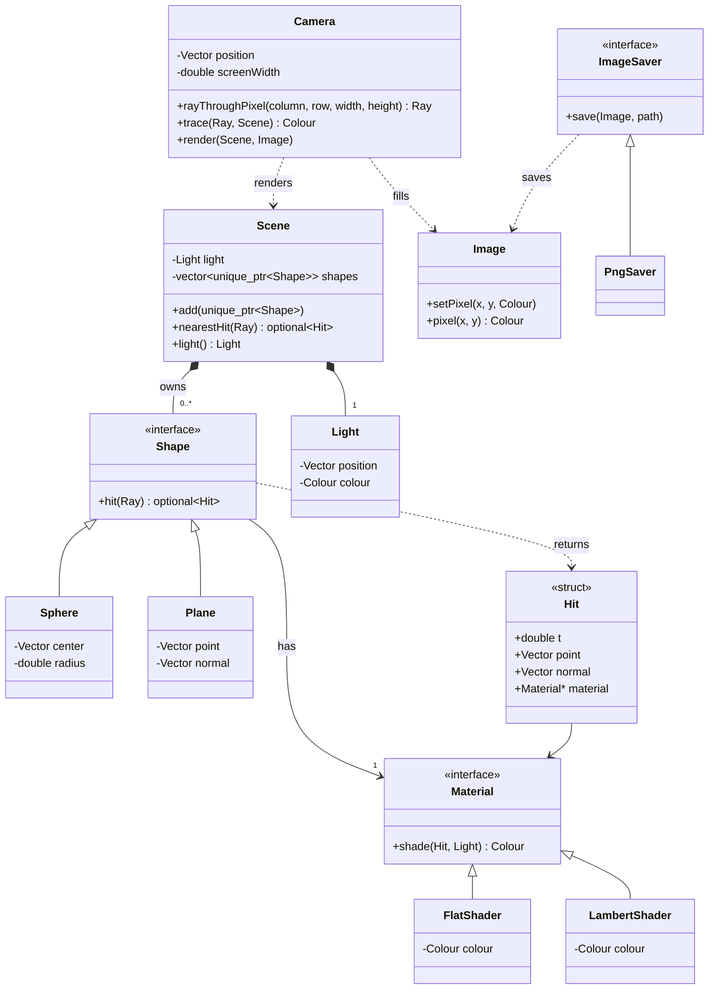

# Domain model

State at milestone m1: a scene of shapes, lit by one point light, seen by a pinhole camera.

## How a pixel gets its colour

1. `Camera::rayThroughPixel` builds a `Ray` from the eye through the pixel.
2. `Scene::nearestHit` asks each `Shape` for its `Hit` and keeps the one with the smallest `t`.
3. The `Material` in that hit computes the colour with the `Light` (Lambert: `colour × light × max(0, N·L)`).
4. No hit: the pixel is black.

## Ownership

- The **scene owns its shapes** (`unique_ptr`): they are deleted with the scene.
- **Shapes do not own their materials** (`Material*`): materials must outlive the scene. See [ADR 0002](adr/0002-a-shape-has-a-material.md).

## Decisions

- [ADR 0001: Save images as PNG with lodepng](adr/0001-png-library.md)
- [ADR 0002: A shape has a material](adr/0002-a-shape-has-a-material.md)

## Not yet in the model

Shadows, reflections, several lights, other shapes.
